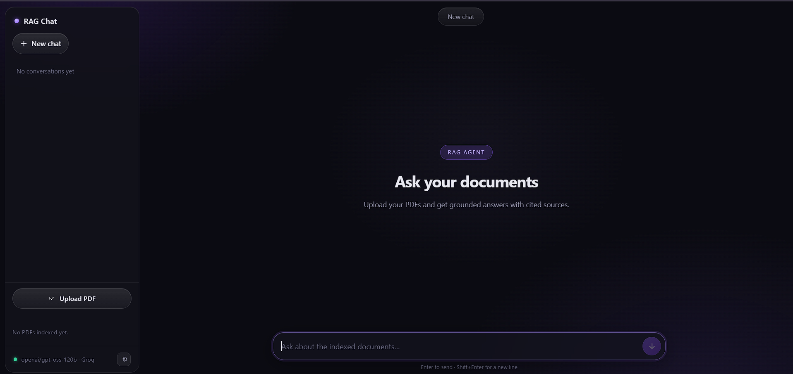

# Rag_Langchain
Agentic RAG chatbot that answers questions from your uploaded PDFs using LangChain, deepagents, and FastAPI.



## 📋 Overview
A document Q&A chatbot that lets users upload PDFs, indexes them into a vector store, and answers questions with cited sources. Built with an agentic architecture: a deep agent plans searches, delegates chunk analysis to subagents, and synthesizes verified answers.

## 🛠 Tech Stack
| Layer | Technology |
|-------|-----------|
| Backend | Python, FastAPI, Uvicorn |
| Agent Framework | LangChain, deepagents |
| Embeddings | HuggingFace sentence-transformers |
| Vector Store | InMemoryVectorStore |
| Frontend | Vanilla HTML/CSS/JS, marked.js, highlight.js |
| PDF Parsing | pypdf |

## ✨ Features
- **PDF Upload**: Upload PDFs for instant indexing and querying
- **Agentic RAG**: Deep agent with chunk-analyst subagent delegation
- **Multi-Provider**: Switch between Groq, Anthropic, Google Gemini, OpenAI-compatible models
- **Streaming UI**: SSE-based token streaming with reading-paced reveal
- **Chat History**: Conversation threads persisted in browser localStorage
- **Settings Panel**: Per-session API key, model, and base URL configuration

## 🚀 Quick Start
```bash
# Clone
git clone https://github.com/19anveshh/Rag_Langchain.git
cd Rag_Langchain

# Install dependencies
uv sync

# Configure environment
cp .env.example .env
# Add your GROQ_API_KEY and HF_TOKEN to .env

# Run
uv run server.py
# Open http://127.0.0.1:8000
```

## 🏗 Architecture
See [`docs/architecture.md`](docs/architecture.md) for the RAG workflow diagram and subagent delegation flow.

## 🧪 What I Learned
- Streaming LLM responses over SSE with a reading-paced reveal
- Building a per-request agent cache keyed by provider/model/key
- Handling pacer/finalize race conditions in streaming UIs
- Indexing PDFs into a vector store with HuggingFace embeddings

## 🔮 Next Steps
- Persistent vector store (Chroma/Pinecone) instead of in-memory
- User authentication and multi-tenant document isolation
- Docker deployment

## 📄 License
MIT

---
**Maddela Anvesh** · 2nd Year B.Tech CSE · [LinkedIn](https://linkedin.com/in/19anveshh) · [Portfolio](https://19anveshh-portfolio.vercel.app/)